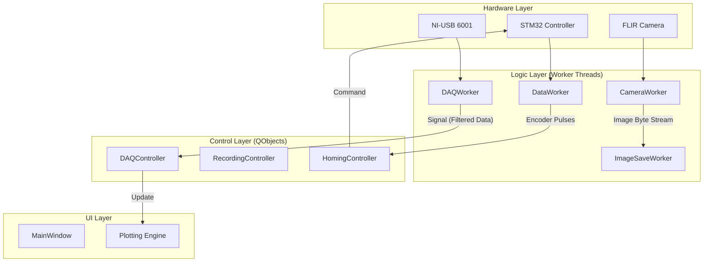

# InsituMicron GUI: Technical Documentation & Architecture Guide

Welcome to the technical guide for the **InsituMicron GUI**, the control software for uniaxial and biaxial material testing systems. This document is designed for developers, engineers, and curious beginners who want to understand how this software is built, how it communicates with hardware, and how it handles complex real-time data.

---

## 1. Project Overview
The InsituMicron GUI is a high-precision testing application. Its primary job is to:
1.  **Control Motors**: Move actuators at precise speeds (mm/min) to apply load to a sample.
2.  **Acquire Data**: Read high-frequency data from Load Cells (Force) and LVDTs (Displacement).
3.  **Visualize**: Provide real-time graphs of Load vs. Time, Displacement vs. Time, and Load vs. Displacement.
4.  **Record**: Save every data point and synchronized camera images for post-test analysis.

### Tech Stack Rationale: Why these tools?
Choosing the right tools is the difference between a buggy prototype and a professional product. Here is why we chose our stack:

*   **Python**: Chosen for its "batteries-included" ecosystem. It allows us to integrate complex camera SDKs (PySpin), scientific data processing (NumPy), and professional graphing (PyQtGraph) seamlessly.
*   **PySide6 (Qt for Python)**: We chose PySide6 because it provides a commercial-friendly license (LGPL) and a robust, industrial-strength framework for building Windows desktop applications. It handles the "Event Loop" that keeps the UI responsive even while the hardware is screaming with data.
*   **PyQtGraph**: Standard Python plotting libraries (like Matplotlib) are too slow for real-time updates at 30Hz+. PyQtGraph uses Hardware Acceleration (via Qt) to render thousands of points without breaking a sweat.
*   **NI-DAQmx**: We integrated with National Instruments hardware because they are the industry gold-standard for reliability in material science.
*   **Spinnaker (PySpin)**: This allows direct, low-level control over FLIR industrial cameras, ensuring we can capture synchronized TIFF images without compression artifacts.

---

## 2. High-Level Architecture
The software follows a **Controller-Worker** pattern. Because talking to hardware is slow and unpredictable, we *never* do it on the main UI thread. If we did, the window would "Freeze" every time a motor started.

### The Multi-threaded Design
1.  **UI Thread (Main)**: Handles buttons, sliders, and updating the screen.
2.  **DAQ Thread**: A dedicated "hot" thread that reads data from the NI-DAQ USB device at 1000 times per second (1kHz).
3.  **Serial Thread**: Listens to the STM32 Motor Controller for encoder feedback.
4.  **Camera Thread**: Pulls raw image frames from the FLIR camera.
5.  **Image Save Thread**: A background "sink" that writes TIFF files to the disk so the camera thread can get back to work immediately.

### Data Flow Diagram


---

## 3. Getting Started
To run this project from source, you need more than just the code. You need the "bridge" between the software and the physical world.

### Prerequisites (Hardware & Drivers)
1.  **NI-DAQmx Runtime**: Required for `daq_handler.py`. Download from [ni.com](https://www.ni.com/en/support/downloads/drivers/download.ni-daq-mx.html).
2.  **Spinnaker SDK**: Required for `gui.py` to see the camera. Download from [Teledyne FLIR](https://www.flir.com/products/spinnaker-sdk/).
3.  **STM32 VCP Driver**: Allows the USB connection to the motor controller to appear as a COM port.

### Python Environment
Install dependencies via pip:
```bash
pip install -r requirements.txt
```
The entry point of the entire application is `main.py`.

---

## 4. Core Components Deep Dive
This section explains the responsibility of every major file in the repository.

### A. Entry & Configuration
*   **`main.py`**: The "Power Button" of the app. It initializes high-priority settings like **DPI Scaling** (crucial for 4K monitors) and launches the `QApplication`.
*   **`constants.py`**: Centralized brand settings. Changing `PRIMARY_COLOR` here updates the entire UI instantly.
*   **`settings.py`**: Handles persistent user preferences (like the last used folder or calibration constants) by saving them to a JSON file.

### B. UI Layer Foundations
*   **`theme.py`**: A centralized CSS-like stylesheet. It defines the "look and feel" of buttons, input fields, and group boxes using Qt Style Sheets (QSS).
*   **`dpi_scaling.py`**: Contains the logic to detect screen resolution and apply counter-scaling factors so the UI looks consistent across different laptops.
*   **`gui_panels.py`**: Defines reusable UI blocks like the `ConnectionPanel` (for USB setup) and `SamplePanel` (for entering sample dimensions).
*   **`gui_test_views.py`**: Contains the main dashboard layouts, including the `UniaxialMotorControlPanel` and `SensorDisplayPanel`. This is where the interactive magic happens.

### C. Logic Core (The Brains)
*   **`gui.py`**: The integration hub. It connects the buttons in `gui_panels.py` to the logic in `controllers.py`. If you want to know what happens when a button is clicked, start here.
*   **`controllers.py`**: This is where "Business Logic" lives. It is divided into specialized managers:
    *   `ErrorManager`: Buffers hardware disconnects to prevent "Alert Fatigue" (showing 10 popups at once).
    *   `DAQController`: Manages the lifecycle of the NI-DAQ hardware.
    *   `HomingController`: A state machine that drives the motor until it reaches the "Home" encoder position.
    *   `RecordingController`: Handles the complex dance of creating folders, starting CSV streams, and exporting to Excel.
*   **`interfaces.py`**: Defines "Protocols" (contracts). It ensures that both the Serial and DAQ workers speak the same language so the UI can switch between them easily.

### D. Hardware Layers (The Muscle)
*   **`daq_handler.py`**: A high-performance worker that talks to National Instruments devices. It uses **NumPy** for fast array processing and applies real-time filters to the data.
*   **`serial_handler.py`**: Manages the low-level USB serial connection to the STM32 controller. It runs a dedicated read loop to ensure no commands are missed.
*   **`logging_config.py`**: Sets up industry-standard rotating logs. If something goes wrong in the field, the `logs/` folder is the first place to look.

---

## 5. Implementation & Optimization Journey
Building this software wasn't straightforward. We iterated through several challenges to reach the current performance.

### 5.1 The Scaling Solution
**Challenge**: On high-resolution laptops (like a Surface or Dell XPS), Qt applications often look tiny or blurry.
**Iteration**: We first tried standard scaling, but it made fonts too large.
**Decision**: We arrived at a "Counter-Scale" strategy in `main.py`. By detecting 150% scaling and applying a `0.66` factor, we neutralized the Windows default, keeping our 18px design sharp and perfectly sized.

### 5.2 Signal/Slot Thread Safety
**Challenge**: Passing data from the DAQ thread (1kHz) to the UI thread (30Hz) can cause "Race Conditions" where the app crashes because the UI is reading data that the hardware is currently writing.
**Iteration**: We initially tried `QMutex` (locks), but it slowed down the acquisition.
**Decision**: We moved to a **Lock-Free** design using Qt Signals. Crucially, as seen in `daq_handler.py`, we call `.copy()` on every list before emitting it. This gives the UI its own private copy of the data, allowing the hardware thread to keep running at full speed.

### 5.3 Post-Process Logging
**Challenge**: Writing to Excel (`.xlsx`) is slow. Doing it during a test caused the UI to lag.
**Decision**: We switched to **CSV Streaming**. We write raw text to a simple `.csv` file in real-time. When the user clicks "Stop", a background `ExcelExportWorker` converts that CSV into a formatted Excel report. This ensures data is safe even if the power fails.

---

## 6. Packaging & Deployment
Distributing Python code is hard because the end-user usually doesn't have Python installed. We solve this with a two-step packaging process.

### 6.1 PyInstaller (`build.spec`)
We use PyInstaller to "freeze" the code into a standalone `.exe`. The `build.spec` file is a recipe that tells PyInstaller:
*   Which folders to include (like `LICENSES`, `app_icon.ico`).
*   Which libraries are tricky (NI-DAQmx and Spinnaker metadata must be manually collected).
*   To hide the terminal window (`console=False`).

### 6.2 Inno Setup (`installer.iss`)
The `.exe` is then wrapped in a standard Windows Installer (`.iss`). This ensures the user doesn't just get a folder of files, but a professional wizard that:
*   Asks for Administrator privileges.
*   **Auto-Installs Drivers**: It checks if the STM32 and National Instruments drivers are missing and installs them automatically.
*   Creates Desktop and Start Menu shortcuts.

---

## 7. Safety & Error Handling
Since this software controls physical motors that can crush metal (and fingers!), safety is paramount.

1.  **Hard Stops**: If the sensor load exceeds 5000N (the limit of our frame), the software sends a `STOP` command instantly to prevent damage.
2.  **Break Detection**: The software monitors the load. If it sees a sudden "drop" in force (e.g., 1000N in 10ms), it assumes the sample has snapped and stops the motor automatically.
3.  **Hot-Plug Recovery**: If you accidentally unplug the USB cable during a test, the `ErrorManager` detects it, stops the motor commands, and tries to save whatever data was in the buffer before asking you to reconnect.

---

## Conclusion
The InsituMicron GUI is a robust bridge between high-speed hardware and a user-friendly interface. By offloading heavy tasks to worker threads and following strict data contracts, it provides a reliable platform for precise material testing.

*This documentation was generated for version 3.1.2.*
